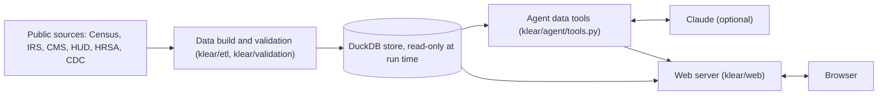

# KLEAR

Live site: https://klear-1036571590730.us-west1.run.app/ (no setup needed; it asks for a password until the finals demo)

KLEAR answers questions about Hawaiʻi's 51 House and 25 Senate legislative districts for the HAIC 2026 Know Your District challenge. A data pipeline builds a district-level fact base from Census, ACS, federal and state sources into DuckDB, with every fact tied to a source. Program eligibility rules live in YAML files. An agent built on Claude answers questions using only the store, and an eval checks its answers against a set of test questions.

## For judges

- Team: [team name as registered with HAIC]
- The quickest way to try KLEAR is the live site above: no setup, keys or download. Until the finals demo it asks for a password.
- Security and privacy: [docs/SECURITY-PRIVACY.md](docs/SECURITY-PRIVACY.md). How the numbers are checked: [docs/VALIDATION.md](docs/VALIDATION.md).

One-minute tour:

1. Type a town, such as Kāneʻohe, in the search box. KLEAR lists the House and Senate districts that hold it and the share of its residents in each.
2. Pick a district. Its profile opens beside the chat: four headline figures, then the full profile, each figure with its margin of error or range and its county and state values.
3. Ask one of the suggested questions, or your own. Each answer shows its figures as cards and charts with their sources. Open a source to see the publisher's page.
4. Open Outreach in the menu to see which districts have the most people who meet a program's income test.
5. Open How we check KLEAR in the footer to see every check the last data build ran.

Results, from the data build of November 12, 2026 HST and the tests run on it:

| What | Result |
| --- | --- |
| Districts covered | 76 of 76 (51 House, 25 Senate) |
| Data checks in the build ([docs/VALIDATION.md](docs/VALIDATION.md)) | 23 of 23 pass |
| DBEDT workbook values compared with the Census Data API | 177,776 values, 0 mismatches |
| Stored figures compared with DBEDT's district profiles | 3,854 figures, 0 differ |
| Program rule values checked against official pages | 260 values in 15 rule files, 0 mismatches |
| Programs in the catalog (data/programs) | 12 state and federal programs |
| Scripted replay of the 59 practice questions (saved model replies, no API calls) | 59 of 59 pass |
| Recorded live run on the practice set (Claude Haiku 5.5, rescored on this build) | 48 of 50 scored answers correct, every number from the store |
| Python tests (pytest) | 2,063 passed, 0 failed (61 tests that call live servers run separately) |
| Browser tests at desktop and phone sizes (Playwright), including 24 axe accessibility scans for WCAG 2.2 A and AA | 130 passed, 0 failed (8 desktop-only checks skipped at phone size) |

To run KLEAR on your own computer instead, you first build the data store from public sources. That needs Python 3.12 or later, [uv](https://docs.astral.sh/uv/getting-started/installation/), internet access and a free Census API key ([sign up here](https://api.census.gov/data/key_signup.html)) saved in a .env file as in [Local keys](#local-keys). No paid key is needed.

```sh
git clone https://github.com/HAIC-2026/KLEAR.git
cd KLEAR
uv sync --locked
uv run python -m klear.etl build
uv run python -m klear.web --basic-only --open
```

The build takes several minutes the first time. Two HUD files must be downloaded by hand (see [Build the data store](#build-the-data-store)). Without them the build ends with exit code 2 and leaves out HUD's housing cost figures and its income limit check, but search, profiles and chat still work. --basic-only makes no AI model calls: answers come from free lookups in the store. Without a built store, the landing page and map still open, but search and chat stay off.

## How answers stay grounded

1. The model never types a figure. It writes sentences with markers such as {fact:f3}, each naming a fact that a data tool returned, and the server fills in the value, margin of error, survey years and source from the store (klear/eval/contract.py, klear/agent/answer.py).
2. Code checks every answer before it is shown (build_answer in klear/agent/answer.py, answer_problems in klear/eval/scorers.py): one of five answer types (an answer, a declined personal request, a declined partisan request, data not available, or out of scope), no number outside a marker, every cited fact used, only the places the question is about, every figure the question type requires, and comparison words that match the numbers. A failing answer goes back to the model with the problems. If it still fails after 6 calls, code writes a plain answer from the facts already looked up.
3. Each figure on the page shows its survey years, its margin of error or range and a link to its source, and an estimate whose margin of error is large is marked unreliable (klear/web/display.py).
4. Basic mode needs no model. With --basic-only, without an Anthropic key, or once the daily cap is reached, a keyword lookup answers from the same store with the same layout (klear/web/answers.py).
5. Answers to the five starter questions can be prepared ahead with python -m klear.web.prewarm. They pass the same checks, and the site uses one only for the same question, district, store build and model, and says it was prepared ahead.
6. Every data build checks the store before the site uses it (docs/VALIDATION.md): DBEDT's ACS workbooks against the Census Data API cell by cell, stored figures against DBEDT, program rule values against quotes on official pages, and sums and ranges against their parts. If a gated check fails, the previous store is kept.



## Run the site locally

Requires Python 3.12 or later and [uv](https://docs.astral.sh/uv/getting-started/installation/).
The same commands work in PowerShell on Windows, Terminal on macOS, and Linux.
Run them from the project root. No virtual environment activation or separate frontend server is needed.
Use a native Windows checkout in PowerShell or a native macOS checkout in Terminal;
WSL is not required. Run `uv sync --locked` on each machine rather than copying `.venv`
between operating systems.

```sh
git clone https://github.com/HAIC-2026/KLEAR.git
cd KLEAR
uv sync --locked
uv run python -m klear.web --basic-only --open
```

If you already have this checkout, start with `uv sync --locked`.
The last command starts the server at [http://127.0.0.1:8000](http://127.0.0.1:8000)
and opens it in your default browser. Keep the terminal running; press **Ctrl+C** to stop.
`--basic-only` guarantees no model API calls, even if you have an Anthropic key configured.
Omit `--open` if you prefer to open the URL yourself.

**The landing page can be previewed immediately, without keys or downloaded data.**
District search and chat need `data/build/klear.duckdb`. If it is missing, the terminal
prints the build command and the page explains that district lookup is unavailable.
Follow [Build the data store](#build-the-data-store) once to enable those features.

After the store is built, your everyday run command is:

```sh
uv run python -m klear.web --open
```

With `ANTHROPIC_API_KEY` configured, this enables the paid assistant under the daily cap.
Without that key, the site automatically uses free basic lookups from the store.
The terminal reports the URL, data store path, and active mode on startup.

If uv is unavailable after setup, use the environment's Python directly:

| Platform | Run from the project root |
| --- | --- |
| Windows (PowerShell) | `.\.venv\Scripts\python.exe -m klear.web --basic-only --open` |
| macOS (Terminal) | `.venv/bin/python -m klear.web --basic-only --open` |

Remove `--basic-only` to enable the assistant when you have an Anthropic key configured.

### Local keys

Create a `.env` file in the project root using [.env.example](.env.example) as a template.
If `.env` already exists, keep it and add only the missing settings:

```dotenv
CENSUS_API_KEY=your-census-key
ANTHROPIC_API_KEY=
```

- `CENSUS_API_KEY`: a free Census API key, needed for the first data build.
- `ANTHROPIC_API_KEY`: optional; fill it in to enable Claude answers. Those calls cost money.

KLEAR reads keys automatically from the process environment, then the project's `.env`,
then `~/.config/klear/env`, in that order. Blank entries fall through to the next location.
On Windows, the last path is `%USERPROFILE%\.config\klear\env`.
No `source`, environment export, or `--env-file` option is needed. Restart the web server after changing keys.
`.env` is ignored by Git; keys stay on the server and are never sent to the browser.

### Local troubleshooting

- **`uv` is not recognized:** install uv using the link above, then reopen your terminal.
  An already synced checkout can use the platform-specific Python command in the table above.
- **Port 8000 is already in use:** run `uv run python -m klear.web --port 8001 --open`.
- **The page opens but district search fails:** build the store below, or use `--store PATH`
  to select an existing `klear.duckdb`.
- **The terminal says the data store was built by an older KLEAR:** the store's tables changed since
  it was built, so district search, profiles and chat stay off until you run
  `uv run python -m klear.etl build` again. It reuses the downloads in `data/raw`.
- **The site uses basic lookups:** check `ANTHROPIC_API_KEY` in `.env`, restart the server,
  and leave off `--basic-only`. The site also falls back to basic lookups if the daily cap
  is reached or the API is unavailable.

## Known limitations

- The ACS figures cover survey years 2020 to 2024, so most of the responses behind them predate the August 2023 Maui wildfires.
- Figures moved to districts from ZIP codes (IRS and CMS) are wide ranges, too wide to rank districts by.
- Income-eligible counts, such as people under 138 percent of poverty, meet the income test only. KLEAR does not decide anyone's eligibility.
- No DBEDT, Department of Taxation or BLS figures yet (issue #31). DBEDT's ACS workbooks are used only to check the Census figures.
- The program catalog has 12 state and federal programs and no county programs.
- Each question stands alone. The chat shows earlier messages but does not send them with a new question.
- The free fallback lookup, used without an AI key or when the daily cap is reached, matches keywords. It answers fewer kinds of questions than the assistant.
- No person has tested the site with a screen reader yet (see [docs/ACCESSIBILITY.md](docs/ACCESSIBILITY.md)).
- English only.
- The included Python server is a demo server, not a hardened public host. See [docs/SECURITY-PRIVACY.md](docs/SECURITY-PRIVACY.md) for what production would add.

## Services and data KLEAR depends on

Two outside services can be called while the site runs. Both are optional.

| Service | Publisher | What KLEAR sends and why | Terms |
| --- | --- | --- | --- |
| Anthropic API, model claude-haiku-5-5 | Anthropic | The question and the public figures the assistant looks up, to write the answer. Used only when ANTHROPIC_API_KEY is set; --basic-only or no key uses the free lookup instead. | [Commercial Terms](https://www.anthropic.com/legal/commercial-terms), [Usage Policy](https://www.anthropic.com/legal/aup), [Privacy Policy](https://www.anthropic.com/legal/privacy) |
| Census Geocoder | U.S. Census Bureau | A street address typed in search or chat, to find its 2020 Census block. --no-address-lookup turns it off. | [Policies and notices](https://www.census.gov/about/policies.html), [privacy policy](https://www.census.gov/about/policies/privacy.html) |

The data build (python -m klear.etl build) downloads everything else. It runs ahead of time, not when someone uses the site. The store holds facts from these 11 sources:

| Source | Publisher | How the build gets it | Terms |
| --- | --- | --- | --- |
| [ACS 5-year Data Profiles, 2020-2024](https://www.census.gov/acs/www/data/data-tables-and-tools/data-profiles/2024/) | U.S. Census Bureau | Census Data API, with a free key | [Census Data API terms of service](https://www.census.gov/data/developers/about/terms-of-service.html) |
| [ACS 5-year Detailed Tables, 2020-2024](https://www.census.gov/programs-surveys/acs/data/data-tables.html) | U.S. Census Bureau | Census Data API, with a free key | [Census Data API terms of service](https://www.census.gov/data/developers/about/terms-of-service.html) |
| [IRS Statistics of Income ZIP code data, tax year 2023](https://www.irs.gov/statistics/soi-tax-stats-individual-income-tax-statistics-2023-zip-code-data-soi) | Internal Revenue Service | CSV download | [U.S. government work, no copyright](https://www.usa.gov/government-copyright) |
| [Marketplace 2026 open enrollment public use files](https://www.cms.gov/data-research/statistics-trends-reports/marketplace-products/2026-marketplace-open-enrollment-period-public-use-files) | Centers for Medicare & Medicaid Services | ZIP download | [U.S. government work, no copyright](https://www.usa.gov/government-copyright) |
| [Housing Choice Vouchers by Tract](https://hudgis-hud.opendata.arcgis.com/datasets/HUD::housing-choice-vouchers-by-tract) | U.S. Department of Housing and Urban Development | HUD's ArcGIS map service | [U.S. government work, no copyright](https://www.usa.gov/government-copyright) |
| [Public Housing Developments](https://hudgis-hud.opendata.arcgis.com/datasets/HUD::public-housing-developments) | U.S. Department of Housing and Urban Development | HUD's ArcGIS map service | [U.S. government work, no copyright](https://www.usa.gov/government-copyright) |
| [Low-Income Housing Tax Credit projects](https://hudgis-hud.opendata.arcgis.com/datasets/HUD::low-income-housing-tax-credit-properties-1) | U.S. Department of Housing and Urban Development | HUD's ArcGIS map service | [U.S. government work, no copyright](https://www.usa.gov/government-copyright) |
| [CHAS 2018-2022, Table 8](https://www.huduser.gov/portal/datasets/cp.html) | U.S. Department of Housing and Urban Development | Saved by hand in data/manual (the site blocks scripts) | [U.S. government work, no copyright](https://www.usa.gov/government-copyright) |
| [Health center service delivery and look-alike sites](https://data.hrsa.gov/data/download?data=HCC) | Health Resources and Services Administration | CSV download | [U.S. government work, no copyright](https://www.usa.gov/government-copyright) |
| [PLACES 2025, census tract data](https://data.cdc.gov/500-Cities-Places/PLACES-Local-Data-for-Better-Health-Census-Tract-D/cwsq-ngmh) | Centers for Disease Control and Prevention | data.cdc.gov CSV download | [Use of CDC materials](https://www.cdc.gov/other/agencymaterials.html) |
| [PLACES 2025, county data](https://data.cdc.gov/500-Cities-Places/PLACES-Local-Data-for-Better-Health-County-Data-20/swc5-untb) | Centers for Disease Control and Prevention | data.cdc.gov CSV download | [Use of CDC materials](https://www.cdc.gov/other/agencymaterials.html) |

The build and its helper scripts also read these, to draw districts, place people in them, spell place names and check the figures. None of them adds a figure of its own:

- U.S. Census Bureau: 2020 Census redistricting data (P.L. 94-171) through the Census Data API, and TIGER/Line 2020 blocks and county subdivisions, the 2020 ZIP code area relationship file, block assignment file and place gazetteer from www2.census.gov ([Census Data API terms of service](https://www.census.gov/data/developers/about/terms-of-service.html)).
- Hawaiʻi Statewide GIS Program: the official 2022 House and Senate district boundaries ([program page](https://planning.hawaii.gov/gis/)).
- Hawaiʻi Office of Elections: the 2022 Reapportionment Commission's final district population files ([commission page](https://elections.hawaii.gov/about-us/boards-and-commissions/reapportionment/)).
- DBEDT Research and Economic Analysis Division: the 2020-2024 ACS profile workbooks, compared cell by cell with the Census Data API ([DBEDT census page](https://census.hawaii.gov/)).
- City and County of Honolulu: neighborhood board areas, for search on Oʻahu ([Honolulu Open Geospatial Data](https://honolulu-cchnl.opendata.arcgis.com/)).
- U.S. Geological Survey: Geographic Names Information System names, read by klear/etl/gazetteer_names.py to write the Hawaiian spellings in data/places/hawaiian_names.yaml ([GNIS](https://edits.nationalmap.gov/apps/gaz-domestic/public/search/names), [U.S. government work, no copyright](https://www.usa.gov/government-copyright)).
- State and federal program pages: each rule in data/rules is checked against a quote on the page named in its source_url, and each program in data/programs links to its official page.

This product uses the Census Bureau Data API but is not endorsed or certified by the Census Bureau.

## Layout

- klear/etl: downloads the sources and builds the store (python -m klear.etl build).
- klear/store: the DuckDB schema and the writer that rejects unsourced facts.
- klear/validation: the build's validation checks and the docs/VALIDATION.md report.
- klear/rules: loads the program rules and checks each value against its official source quote. python -m klear.rules check rechecks the rules and program contacts against the live pages.
- klear/agent: the agent, its data tools and the code that builds and checks each answer (python -m klear.agent).
- klear/web: the local web server, landing page, district profile and chat interface (python -m klear.web).
- klear/eval: the answer format, eval runner, answer checks, reports and spending cap (python -m klear.eval run).
- data: the checked-in indicator catalog and the official program counts the validation report compares with (data/catalog), Hawaiian place names and district search names (data/places), the program catalog the site and the assistant list programs from, with each program's agency, official page and phone (data/programs), and program rules (data/rules). The build also writes data/raw (download cache), data/manual (hand downloads) and data/build (the store), none of them tracked.
- eval: test questions (eval/golden), saved model replies (eval/scripts), recorded live answers (eval/recordings) and model prices. Run reports go to eval/reports, which is not tracked.
- tests: the pytest suite, laid out like the klear packages, with small fixtures in tests/fixtures.
- e2e: browser and accessibility tests with Playwright and axe (see [Browser and accessibility tests](#browser-and-accessibility-tests)).

## Build the data store

Add `CENSUS_API_KEY` to `.env` as described above, then run:

```sh
uv run python -m klear.etl build
```

This downloads public datasets, builds the fact store, runs validation checks and writes the report.
It needs internet access; the first build can take several minutes and later builds reuse `data/raw`.
It makes no Claude calls. Request URLs in logs and provenance files mask the Census key as `key=***`.

- --refresh downloads every raw file and Census API response again instead of using the cache in data/raw.
- --skip-network-checks serves Census API calls only from the cache. Checks the cache cannot serve are skipped and reported as skipped. A fully cached build needs no API key.

Manual downloads. Some official sites serve files only to a browser. Download them by hand and save them under `data/manual/` with these names. Until the two HUD files are there, the build skips the steps that need them, names the file and its URL, and exits 2. When all other required checks pass, it still writes a store usable for local district search and basic chat; the missing HUD data is unavailable.

- 2018thru2022-140-csv.zip from https://www.huduser.gov/portal/datasets/cp/2018thru2022-140-csv.zip (HUD CHAS 2018-2022, tract level). This release has no data dictionary, so klear/etl/chas.py names the Table 8 columns itself, and the build checks their Hawaiʻi totals against HUD's published state summary.
- Section8-FY26.xlsx from https://www.huduser.gov/portal/datasets/il/il26/Section8-FY26.xlsx (HUD FY2026 income limits). The build compares data/rules/hud_il_fy2026_hi.yaml with it.

Three program rules also read a saved copy when the live page blocks scripts. Save each from a browser under data/manual/ with the name in the rule's saved field:

- medquest-2026-magi-income-standards.pdf, the 2026 MAGI and MAGI-Excepted Income Standards Chart listed on https://medquest.hawaii.gov/content/medquest/en/resources/rules-and-policy.html (rule medquest_2026).
- ssa-ssi-in-hawaii-2026.pdf from https://www.ssa.gov/pubs/EN-05-11108.pdf (rule ssi_hi_supplement).
- hrs-349-17.html, HRS §349-17 from https://data.capitol.hawaii.gov/hrscurrent/Vol07_Ch0346-0398/HRS0349/HRS_0349-0017.htm (rule kupuna_care). This page usually loads without a saved copy.

The build hashes each manual file once, in a sidecar next to it, and lists it with the raw files in the manifest. Replacing a manual file later fails the raw file hash check. If the new file is intended, delete its .meta.json sidecar and rebuild.

The store in data/build/klear.duckdb is replaced only when no required check failed and every skipped step was skipped for a missing manual input. Otherwise the previous store is kept, and the console, manifest.json (store) and VALIDATION.md say why. The store's build_info table records the build that wrote it: time, code commit, exit code, status, skipped steps and check results.

The last line of the build output gives the exit code and its meaning:

- 0: all required checks ran and passed.
- 1: a required check failed.
- 2: the build is incomplete because a required check was skipped.

Outputs in data/build:

- klear.duckdb: the fact store.
- manifest.json: build time, code commit, skipped checks, store counts and every raw file with its source URL, retrieval time and SHA-256 hash.
- validation.json: full results of every check, the report text the website shows, and the assistant eval results.
- house.geojson and senate.geojson: simplified district polygons for the web.

The build also rewrites docs/VALIDATION.md, the public validation report. After the checks it rescores the newest recorded live run in eval/recordings against the new store (free, no model calls) and adds the published held-out totals from eval/heldout_summary.yaml. The website's How we check KLEAR page (/checks.html, linked from the footer) reads validation.json through /api/checks, so it always shows the latest build.

### Keeping rules and programs current

Every Monday at 8:00 HST, and by hand from the Actions tab, the freshness workflow (.github/workflows/freshness.yml) runs uv run python -m klear.rules check. It fetches each rule's pages and checks its quotes again, fetches each program's page and phone source and confirms the phone number still appears, and warns 30 days before a rule's review_by date. It exits 1 on any change or due date and then opens or updates one issue, "Program information needs review". Sites that block scripts are listed as needing a person and do not fail the run. The site shows when a person last checked each program and asks readers to check the official page once that is more than 90 days ago. docs/KEEPING-CURRENT.md explains how to update a rule or add a program, with a calendar of when each program's figures change.

## Tests and evaluation

The default test run is offline and needs no keys. Tests that need a built store skip
until one exists. Windows runs natively without WSL; process tests that require Unix
`fork` or `SIGKILL` skip on Windows, with threaded tests covering file locking there.
GitHub Actions is configured to run the suite, lint and formatting checks on Windows,
macOS and Linux with Python 3.12, 3.13 and 3.14. The suite includes a real subprocess
startup check that serves the page, assets, district lookup and free chat from a temporary store.

```sh
uv run pytest -q
uv run ruff check
uv run ruff format --check
```

Tests that call the live Census API and state servers carry the `network` marker.
Run those explicitly with `uv run pytest -m network`.

### Browser and accessibility tests

The e2e folder holds Playwright tests that drive the website in real browsers: axe checks for
WCAG 2.2 A and AA, the main flow (search, choose, profile, ask, open a source, come back) at desktop
and phone sizes, keyboard-only use, reflow at 320 px and 200% zoom, text spacing, and screenshots
under simulated color blindness. They run in Chromium and WebKit against `e2e/serve.py`, which serves
the site on the small pytest fixture store with a scripted stand-in for the model, so they need
no data build, network, or API key. They need Node.js 20 or later.

```sh
cd e2e
npm ci
npx playwright install chromium webkit
npx playwright test
npx playwright show-report
```

The report lists any moderate or minor axe findings, and the color blindness screenshots
are in `e2e/test-results`. GitHub Actions runs the same tests in the `browser` job and keeps
the report and screenshots as the `browser-test-results` artifact. The record of automated and manual
checks is [docs/ACCESSIBILITY-CHECKLIST.md](docs/ACCESSIBILITY-CHECKLIST.md).

The free eval plays saved model replies from `eval/scripts` through the agent against
the store. It makes no API calls. It needs the built store and its adjacent `manifest.json`,
or `--store PATH` to select another build. Reports go to `eval/reports`:

```sh
uv run python -m klear.eval run --mode replay --agent scripted
```

Live CLI and eval runs need `ANTHROPIC_API_KEY` and cost money. Their spending is
tracked separately from the website and capped at 60 dollars per user.
Read [eval/README.md](eval/README.md) before running them:

```sh
uv run python -m klear.agent "How many kūpuna live in House District 22?"
uv run python -m klear.eval run --mode live --agent klear --model claude-haiku-5-5
```

## Fact store

The DuckDB store in data/build/klear.duckdb has these tables (schema in klear/store/schema.sql):

- source: every publisher and dataset a fact can come from. A fact without a registered source cannot be stored. url is what the build downloads (an API, a CSV or ZIP file, a map service), kept for provenance. page_url is the publisher's page about the dataset, the only address the website links. manifest.json lists both for every source.
- geography: the state, the counties, the House and Senate districts, and the 2020 tracts and ZCTAs of the block table (geo_type, geo_id, name, parent_county).
- indicator: the curated catalog from data/catalog/indicators.yaml, with label, unit, universe, ACS variable, additive (counts and dollar totals that may be summed across units) and note, a caveat to state with every figure. A catalog entry may list bins instead of one ACS variable: published detailed-table cells summed, with the margin of error as the root sum of squares of theirs. The income-eligible estimates (people under 125, 138, 150 and 200 percent of poverty, uninsured people under 138 and from 138 to 399 percent, kūpuna under 200 percent, households below poverty without SNAP, and working families and individuals below poverty) are built this way from tables B22003, C17002, C27016, B17024, B17014 and B17009, which the Census Bureau publishes for every House and Senate district. They use only published cut points: SNAP's 130 percent limit lies between the stored 125 and 150 percent counts and is never interpolated. Their note says they meet the income test only.
- indicator_coverage: the geography types each indicator is declared for, each marked complete or partial. Every geography of a complete type must have a fact. Partial coverage is for sources that publish only some tracts or ZIP codes.
- coverage_exclusion: named geographies a source does not publish inside a complete coverage, with the reason (IRS and CMS publish no Kalawao County rows).
- build_info: one row describing the build that wrote the store.
- fact: one value per geography, indicator and source, with its margin of error, value_status, moe_status, tier (D direct, A apportioned, P points, M modeled, S summed from published parts, C context) and source table. Tier A and M facts with a value carry value_low and value_high with moe_status range, tier S facts carry them only when some of their parts were not published, and tier D and P facts leave both empty. The method the assistant states for each fact comes from its tier, source and geography type (klear/store/methods.py).
- site: public housing, LIHTC and health center points with their House and Senate district, the meters the point was snapped to reach it, and source.
- place and place_overlap: Census 2020 places (CDPs) with Hawaiian names, and the share of each place's 2020 residents in each county, House and Senate district and ZIP code area.
- area, area_overlap and area_alias: what district search finds beyond Census places. Islands, Honolulu neighborhood board areas (City and County of Honolulu) on Oʻahu and Census county divisions (TIGER 2020) on the other islands, each with its main island and its residents' shares in each county, district, ZIP code area and place. Each 2020 block counts in the area holding its internal point. area_alias holds other names people use, such as Kona, upcountry Maui or Lanikai, from data/places/areas.yaml.

Sources beyond the Census Bureau, each moved to House and Senate districts with a range: IRS SOI tax year 2023 returns and earned income tax credit by ZIP code, CMS 2026 marketplace enrollment by ZIP code, HUD housing choice vouchers by tract, CDC PLACES 2025 modeled need by tract and HUD CHAS 2018-2022 cost burden by tract. HUD public housing, LIHTC projects and HRSA health center sites are stored as points with their districts.

County and state values. Every profile figure can be compared with its county and the state. PLACES county values are the CDC PLACES 2025 county estimates from the same release as the tracts. CDC publishes no state value for these measures, so the state value is derived: the average of the five county estimates weighted by adult population, labeled as derived wherever it is shown. Vouchers are summed from the published tracts to counties and the state, site counts and units are counted from the site points by county (the 2020 Census block that holds each point) and for the state, and the four CMS county rows are summed to a state row. The build checks that each sum equals its parts and that every county and state value has a source, tier and method. Program rules (poverty guidelines, SNAP, WIC, EITC, SSI and others) live in data/rules/ as YAML, and every build checks each confirmed value against a quote on its official page. Each rule has a source_url, the page its values are checked against (read from fetch_url when that is set), and an info_url, where residents learn about the program or apply.

Ranges. For counts moved from ZIP codes or tracts, value_low counts only units wholly inside the district, and value_high counts every unit touching it plus the most a suppressed unit touching it could hide. The IRS 99999 amount has no known location: it is assigned to districts by 2020 population and value_high includes only the district's population share of it, so its true district share is not inside the guaranteed range. A CMS county residual is placed in that county's suppressed ZIP codes and counted whole in value_high of every district they touch, but the residual location is assumed, not published. PLACES district ranges average the tract confidence limits with the same weights as the estimate, so they assume tract errors move together and are wider than a formal interval, and a suppressed tract counts as 0 in value_low and 100 percent in value_high. The derived PLACES state range averages the county confidence limits the same way. A summed voucher total for a county or the state counts the published tracts in value_low and adds 10 to value_high for each tract HUD did not publish (10 or fewer voucher holders). The website explains these ranges in plain language on its methods page (klear/web/static/methods.html, served at /methods.html), with a section for each source, and every apportioned or modeled figure links to its source's section.

## Status vocabulary

Every fact carries two statuses. The agent must report each fact with the phrase given here.

value_status, what the value is:

| Status | Meaning | Agent says |
| --- | --- | --- |
| ok | the published estimate | "X" |
| top_coded | published as "X+", value holds X | "X or more" |
| bottom_coded | published as "X-", value holds X | "X or less" |
| suppressed | not published by the source because too few survey responses, enrollees or households fall in the area, value is empty | "not available, too few cases for the source to publish" |
| not_applicable | the measure does not apply here, value is empty | "not applicable here" |

moe_status, what the margin of error is:

| Status | Meaning | Agent says |
| --- | --- | --- |
| ok | the published 90% margin of error | "X, plus or minus M" |
| controlled | estimate fixed to official population totals, no sampling error | "X, fixed to official population totals, no margin of error" |
| open_ended | the value is top or bottom coded | "X or more" or "X or less", with no margin |
| not_computable | too few sample cases to compute a margin | "X, margin of error not available, treat as uncertain" |
| not_applicable | no margin of error applies | no margin given |
| range | moe is NULL, value_low and value_high bound the value | "about X (range L to H)" |

Raw Census and DBEDT codes map onto these statuses in klear/etl/acs_values.py and nowhere else.

## Landing page and chat

See [Run the site locally](#run-the-site-locally) for startup instructions.
With an Anthropic key configured, questions go to the same KLEAR assistant that
`python -m klear.agent` runs. Without the key, the site uses free basic lookups.

When an answer says the data is not available or is outside KLEAR's scope and shows no figures, the site adds one line linking to datatrove.ai (https://datatrove.ai/), a HAIC 2026 sponsor with its own chat over Hawaiʻi public datasets that are not published by district. The line is added where the page lays out the answer, not by the model, so the answer contract and the eval are unchanged. KLEAR only links to datatrove.ai and does not copy its data. The Data and sources and About sections of the page link to it too.

Website spending has its own cap of 5 dollars per HST day, kept in ~/.config/klear/web_spend.json and separate from the 60 dollar eval cap. Each question reserves its worst-case cost first and then records the actual cost. When the day's cap is reached or the API fails, the site falls back to a basic keyword lookup from the store and says so. Each visitor can ask 6 questions a minute, and the server answers 3 at a time.

| Option | Purpose |
| --- | --- |
| `--open` | Open the site in your default browser after binding the server. |
| `--basic-only` | Make no model calls, even if an Anthropic key is present: use free lookups and any prepared starter answers. |
| `--port 8001` | Choose a different port; the default is 8000. |
| `--host 127.0.0.1` | Choose the bind address; the default is local access only. |
| `--store PATH` | Use a different DuckDB store. |
| `--daily-cap 5` | Set the website's model budget in dollars per HST day. |
| `--model MODEL` | Choose the model used by the assistant. |
| `--no-address-lookup` | Turn off street address lookup in search and chat, so the server never contacts the Census geocoder. |

### Outreach page

/outreach.html ("Outreach" in the site menu) compares districts for five pairs of a group and the programs it may qualify for, set in `OUTREACH_PAIRS` in klear/agent/config.py: households in poverty without SNAP (SNAP), uninsured people under 138% of poverty (Med-QUEST), uninsured people from 138% to 399% of poverty (Marketplace premium tax credits), kūpuna under 200% of poverty (SSI, Kūpuna Care and Medicare Savings Programs) and working families and people below poverty (Federal EITC). The reader picks a pair and House or Senate. `GET /api/outreach?pair=ID&chamber=house|senate` ranks the group's direct ACS count with the same tiers as the assistant's rank_districts tool, so districts whose ranges overlap share a group and are listed by number, never in an order the data cannot support. Each district also shows its program-use figure from `PROFILE_BESIDE` (SNAP households, SSI households, EITC returns or Marketplace enrollees with premium tax credits) for comparison only. Figures moved from ZIP codes are too wide to rank. The page opens with a sentence naming the top tier, flags unreliable estimates, and lists each program's page and phone with the income-test caveat. Each district profile has an "Outreach opportunities" note naming up to two pairs whose top tier holds the district, the smallest tier first.

### Prepared answers to the starter questions

The five starter questions ask the same thing for every district, so their answers can be prepared once after each
data build and shown at once instead of after several seconds. With ANTHROPIC_API_KEY set, run:

    uv run python -m klear.web.prewarm

It asks the assistant each starter question for all 76 districts (380 answers), four at a time (--jobs), after showing
the most the run can cost and asking before it spends. The spending counts toward the 60 dollar eval cap. At Haiku 5.5
prices a run costs about 1.50 dollars and takes about 15 minutes. It writes data/build/answer_cache.json and
data/build/answer_cache_sample.md, a random sample of 12 answers with every question at least once. Read the sample
before the demo. If a run stops partway, run it again: it keeps the answers already prepared and asks only the rest.

The server answers a starter question from the file when it holds an answer for that question, district, store build
and model, and says under the answer that it was prepared ahead from the data update of that date. Every other question
goes to the assistant as before, and no typed question is stored. A rebuilt store has a new build time, so its old
answers are no longer used and the next prewarm run drops them. Prepared answers make no model call, so they are served
with --basic-only too. The startup lines say how many prepared answers match the store. To host the site elsewhere,
copy answer_cache.json along with klear.duckdb.

The landing page uses the project-provided `background1.png` photo, copied
as a smaller metadata-free `klear/web/static/background1.jpg`. It loads no
third-party images, fonts, scripts, or analytics.

The KLEAR logo, the island of Oʻahu under a magnifying glass, was drawn for this project as plain
SVG. The coastline is traced from the 2022 Senate district boundaries and simplified.
`klear/web/static/logo.svg` is the mark used in the page header. `favicon.svg` is the same mark on a
teal square, used as the tab icon and the page footer logo. `favicon.ico` (16, 32, and 48 px) and
`apple-touch-icon.png` (180 px) are renders of `favicon.svg` for browsers that do not use SVG icons.

All text is set in Public Sans 2.001 (SIL Open Font License, klear/web/static/fonts/OFL.txt), as a
variable font limited to the weights the site uses (400 to 800). It comes in two files. The page
always loads public-sans.woff2, which holds Latin letters including the Hawaiian kahakō vowels and
ʻokina, punctuation, and math signs. Browsers fetch public-sans-ext.woff2 only when text needs
it: other Latin letters (Vietnamese, Romanian, and more), combining accents, currency signs, and
letterlike symbols. Characters in neither file come from the system font. The arrow on links that leave the site is drawn in CSS, so it looks the same everywhere. To
rebuild both from PublicSans[wght].ttf in the official release
(https://github.com/uswds/public-sans/releases), with fonttools and brotli installed:

    fonttools varLib.instancer "PublicSans[wght].ttf" wght=400:800 -o PublicSans.ttf
    pyftsubset PublicSans.ttf --unicodes="U+0000-00FF,U+0100-017F,U+02BB-02BC,U+02C6-02C7,U+02D8-02DD,U+2000-206F,U+20AC,U+2122,U+2190-21FF,U+2200-22FF,U+FEFF,U+FFFD" --layout-features+=tnum --flavor=woff2 --name-IDs='*' --output-file=klear/web/static/fonts/public-sans.woff2
    pyftsubset PublicSans.ttf --unicodes="U+0180-02BA,U+02BD-02C5,U+02C8-02D7,U+02DE-036F,U+1E00-1EFF,U+2070-20AB,U+20AD-20CF,U+2100-2121,U+2123-218F,U+2C60-2C7F,U+A720-A7FF,U+AB30-AB6F" --layout-features+=tnum --flavor=woff2 --name-IDs='*' --output-file=klear/web/static/fonts/public-sans-ext.woff2

The unicode-range lists in klear/web/static/style.css must match these two lists.

The district map draws the official 2022 House and Senate boundaries as plain SVG, with no map
tiles or map library. Its shapes, and the share of each ZIP area's residents in each district,
live in klear/web/static/districts.json, so the map works
without a data build. After a build changes the boundaries, regenerate it with:

    uv run python -m klear.etl.mapshapes

"Color the map by" shades the map by one of seven rates and medians listed in `MEASURES` in
klear/web/shade.py: people and keiki below the poverty level, the share who are kūpuna, median
household income, renters paying 35% or more of income, people without health insurance and
households receiving SNAP. `GET /api/map?indicator=pct_people_poverty&chamber=house` reads the
measure for every district of the chamber through the rank_districts tool, with no model call, and
returns each district's figure and margin written as its profile writes them, its low and high
ends, a status (ok, unreliable or not available), its shade, and a sentence comparing it with the
state in the profile's words; plus the label, unit, source, year, state figure and each shade's
range. The districts are split into five shades of about equal count, with breaks only where the
written figure changes, so two shades never share a value. Shades run from pale yellow to a dark
shade of the chamber's color (`--house-q1` to `--house-q5` and `--senate-q1` to `--senate-q5` in
style.css), each clearly darker than the last, so the five can be told apart in grayscale and with
any common color vision deficiency. They are set by class, never by a style attribute. Borders and
stripes are ink on the three light shades and white on the two dark ones. Stripes mark an unreliable estimate and dots a
district with no figure, so neither depends on color. The legend gives each shade's range, the
source and year, and says that districts whose margins of error overlap may not differ. The
picked district's figure and state comparison show under the map, and "Show as a table" lists
every district, highest first.

The landing page resolves House/Senate numbers, towns, neighborhoods, islands, counties
and ZIPs using the built store. Overlaps are shown as choices instead of guessing a district:
each place is listed with its island and the share of its residents in each district, and a
place spanning more than eight districts in a chamber leads with a summary, a link that
highlights its districts on the map, and its full list folded. A number out of range says how
many districts the chamber has.

As someone types two or more characters, the search box suggests up to eight matches from the
store through `GET /api/suggest?q=ko`: towns, neighborhoods, islands, counties, county divisions
and other names such as Kona, then ZIP codes for digits and districts for a chamber and a number
(house 2 lists House 2 and 20 to 29). Each suggestion shows its island and kind, and picking one
searches at once for exactly that place, so the Oʻahu Kailua never returns the Hawaiʻi Island one.
The list follows the ARIA combobox pattern: the arrow keys move through it while focus stays in
the box, Enter or a click picks, and Escape closes it. Suggestions never use the geocoder, so
nothing typed leaves the server until the search itself runs.

Search also takes a street address. The server sends it to the U.S. Census Bureau geocoder
(geocoding.geo.census.gov), which returns its 2020 Census block, and looks the block up in the
store, so the districts come from the same 2022 plan as the rest of the site. The address is
used only for that request: it is not stored, the server keeps no request log, and the page
says so beside the search box. If the geocoder is unreachable, search falls back to names and
says so. Start the site with --no-address-lookup to keep every request local.

Chat takes a street address too, as in "Which House and Senate district is 310 W Kaʻahumanu Ave,
Kahului in?". A street address on its own is a place, not a person, so it is answered, not declined.
The assistant passes the address to its resolve_place tool, and the basic lookup finds it in the
question, and both use the same geocoder and block lookup as the search box, then answer for that
district. A town can span districts, so when the geocoder is off, unreachable or finds no match, chat
says so and asks for a place, ZIP code or district instead of guessing one from the town name.
Questions about the people at an address, such as who lives there, are still declined. When the
address is in another district than the one chosen, the answer is labeled with that district, its
next questions name it, and a button switches the chat and profile to it. The matched address is shown
in title case with Hawaiian spelling. The note under the question box says that an AI model writes
answers from KLEAR's data, that the question is sent to its provider, Anthropic, so people should not
type personal details, and that a street address goes to the Census Bureau and is not stored or
logged. The agent and eval command lines take the same --no-address-lookup option.
Chat offers five example questions, a waiting state, explicit refusal labels,
and figure cards with uncertainty, vintage, geography and official source
links. Source names open the publisher's page about the dataset, never an API answer or a
file download. Each ACS figure also links to its table for that place on data.census.gov
(Table DP05 for House District 22, built from the place's Census GEO_ID), where the same number
can be read. Each figure moved to districts from ZIP codes or tracts, or modeled by CDC, links
to its source's section of the methods page instead. Each comparison chart has a sentence saying what it shows (written in
`_summary` in klear/web/display.py) and a data table under it. The examples are a list until a district is chosen, then short buttons
above the question box. Program questions list official guidance without
assessing individual eligibility. Questions outside the available measures
receive a clear limit instead of a guessed answer. Questions are independent:
previous messages are displayed locally but are not sent as conversation history.
After each answer the chat offers up to three next questions, each written out in full with the
district and county named, so the basic lookup can answer them too. A question that takes more
than 45 seconds is stopped. A waiting question can be cancelled, and errors that may pass offer Retry.

Choosing a district also shows its district profile next to the chat. The profile is read
straight from the store with no model call, through `GET /api/profile?district=house:022`.
A district chosen while an answer is still loading shows its profile at once, and the chat switches to it after that answer.
It names the district's counties, islands, Census places and the overlapping districts
in the other chamber, shows four headline figures, then up to 44 figures in eight sections:
People, Income, Housing, Health and access, Programs in use, Who may qualify, Modeled needs and Help sites.
Each figure shows its margin of error or range, is compared with the county that holds most
of the district's population and with the state, flags an unreliable estimate, and is cited
under its section. Rates are compared in plain sentences ("about 40 percent higher than the
rate in Maui County: 9.2%", or "about the same as" when the gap is inside the margins of
error), and totals show the district's share of the county and state total. A county or state
value that KLEAR derived is marked, for example "(average of the CDC county estimates)", and a
place with no value says why, for example "No figure for Kalawao County: CMS publishes no rows for
Kalawao County".
The figures and labels are in `PROFILE_SECTIONS` in klear/agent/config.py and
`PROFILE_LABELS` in klear/web/display.py.

The agent's `district_profile` tool returns the same set, so a profile question in chat,
the free lookup and the page cite the same figures. A question that contains the word
"profile" must cite every profile figure the store holds for its district, and the free
lookup returns them all for a profile, socioeconomic or overview question.

A question about kūpuna on fixed incomes, such as the challenge deck's "How many kūpuna in my district live on
fixed incomes?", gets the same figures from the assistant and the free lookup: the kūpuna count and share, the
median household income of householders 65 and over (B19049), kūpuna under 100 and 200 percent of poverty (B17024),
householders 65 and over living alone (B11007, equal to DP02_0009 plus DP02_0013), and the shares of households
with Social Security, retirement income and SSI. Those shares cover households of every age, and their note says so.
The rates and the median are compared with the county holding most of the district's people and with the state,
and the answer lists SSI, Kūpuna Care, SNAP and Med-QUEST with official links. The assistant's answer is rejected
until it cites each figure, comparison and program, as listed in FIXED_INCOME in klear/agent/config.py.

The assistant and the free lookup follow the same rules for a few kinds of question:

- Housing insecurity, food insecurity, lack of reliable transportation and utility shut-off threats get the CDC
  PLACES measure held for the district, called a modeled estimate, not rent burden.
- Public housing units get the count of units as well as the count of developments.
- A figure tied to a program, such as households receiving SNAP or renters paying 35 percent or more of income on
  rent, names that program (SNAP, HUD income limits) and lists it with its official link. The pairs are in
  TIED_PROGRAMS in klear/agent/config.py.
- A statewide question (statewide, the whole state, Hawaiʻi overall) is answered for the state.
- A question for a year the store does not publish, such as 2025 when the latest survey covers 2020-2024, says
  plainly that the year is not published, gives the latest figures with their years, and is marked as data not
  available.
- The answer builder spells Hawaiian place names with ʻokina and kahakō in the assistant's own words too, leaving
  web addresses and official organization names as written.

On screens at least 1200 px wide the profile and the chat are equal-width columns; below that
the profile sits under the chat at full width. The chat card stays compact until the first
question is sent, then grows to a fixed height and scrolls its conversation inside it. The
profile never scrolls inside itself: it takes the height its figures need, and each section
opens and closes on its own.

Only the static web assets are served; the repository and store cannot be
downloaded. The server rejects cross-origin browser requests. HTTP logs are disabled to avoid recording questions.

For judging access from other devices, deploy behind an HTTPS reverse proxy
with request limits. The included Python HTTP server is a demo entry point,
not a hardened public hosting service. Keep the built store on the server.

Delivery checkpoints (HST): usable for video before November 16, 2026 at
9:00 a.m.; finals demo ready November 21, 2026. Before recording, build and
validate the real store, run a live question and refusal with the operator's
server key, check the deployed URL on mobile, and confirm all source links.
