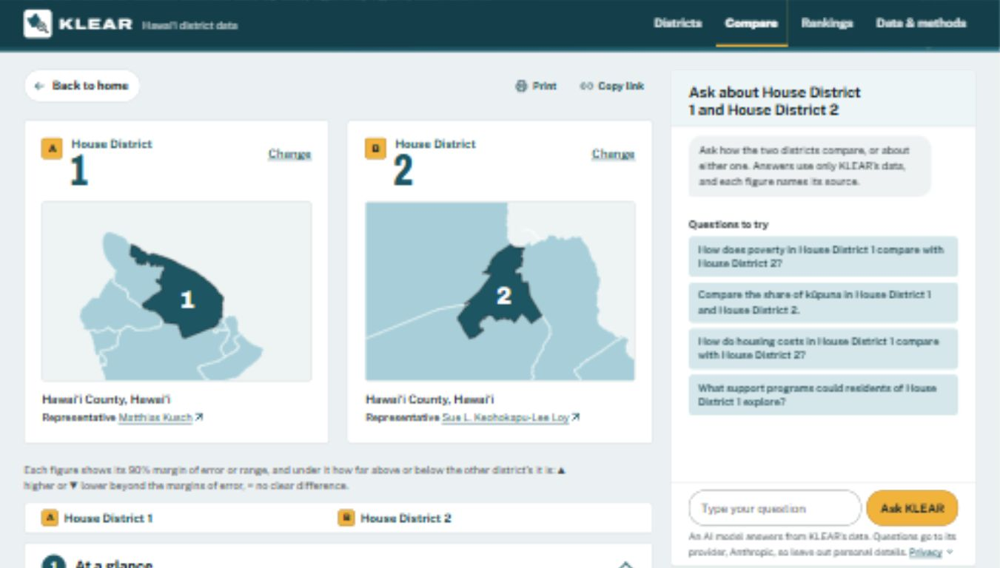
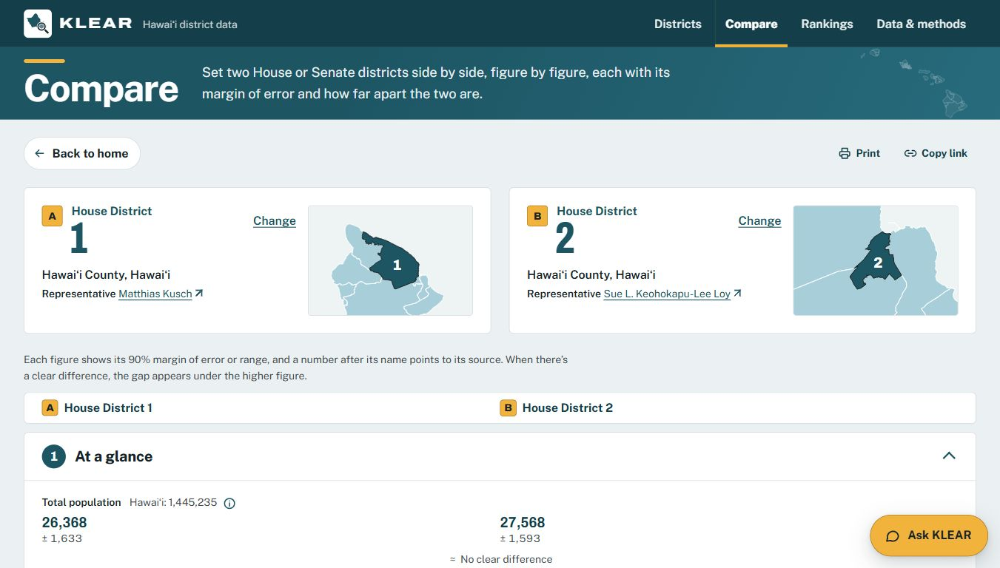

# KLEAR pre-demo review · November 20, 2026

At 1366 × 768, the deployed comparison reserved a third of the page for chat. On this branch, a fresh comparison starts with chat minimized. House Districts 1 and 2 each get 632 px with chat closed and 413 px with it open. Both population figures and their margins of error fit on the first screen.

| Deployed comparison | Branch with chat minimized |
| --- | --- |
|  |  |

## Walkthrough

| Step | Observation and outcome |
| --- | --- |
| 1. Find a district | Searching Hilo returned House and Senate choices with their shares of residents. The shared search control now clears outdated suggestions as soon as the query changes. The home and comparison inputs expose the address privacy note to assistive technology. [District finder](screenshots/01-home.jpg) |
| 2. Select and compare two districts | Both numbered pickers worked on the live site. The branch keeps focus in the selection flow, announces when figures arrive, and lets readers retry a failed comparison or change either district. Compact maps bring the numbers higher on the page. [Live pickers](screenshots/02-compare-pickers.jpg) · [Phone comparison at 320 px](screenshots/13-phone-compare.jpg) |
| 3. Ask about the comparison | The branch docks chat beside the figures on a laptop. Escape and Minimize return focus to Ask KLEAR. Reopening chat preserves the draft. Opening an individual profile now gives the correct single-district greeting. The live Kāneʻohe starter also returned a sourced answer that distinguished district counts from town counts. [Open chat on the branch](screenshots/12-comparison-chat.jpg) |
| 4. Read a profile, explore programs, and print | House District 1 opened from Compare. Its Programs and help link reached the intended section, and Print opened the section chooser. The branch offers a profile retry and waits for the selected figures before enabling Print. [Profile](screenshots/04-profile.jpg) · [Programs](screenshots/05-programs.jpg) · [Print options](screenshots/06-print.jpg) |
| 5. Rank districts and explore outreach | The deployed ranking displayed estimates and margins of error. Outreach grouped districts and explained overlapping ranges. Ranking links on the branch now restore measure, chamber, and order after a refresh or a visit to Outreach. [Rankings](screenshots/07-rankings.jpg) · [Outreach](screenshots/08-outreach.jpg) |
| 6. Inspect sources and checks | The source table, glossary, checks, privacy section, and accessibility statement were reachable. The deployed readiness endpoint reported a healthy store and 380 prepared answers. The statement on the branch describes the new chat controls. [Data and methods](screenshots/09-data.jpg) · [Accessibility statement](screenshots/10-accessibility.jpg) |

## Verification and release

The before screenshots came from the [Cloud Run demo](https://klear-1036571590730.us-west1.run.app/). The branch screenshots used the local full district store in basic lookup mode. Automated tests exercise the assistant and basic lookup separately, including print and share, keyboard navigation, phone reflow, and axe accessibility checks. The projector check used a laptop-sized viewport. A physical projector and a human screen-reader session remain unverified.

The deployed comparison script inspected on November 20 fetched district profiles separately. The repository’s main branch already uses the paired comparison endpoint. The public demo needs a deployment containing this PR to show the tested layout and comparison behavior.
